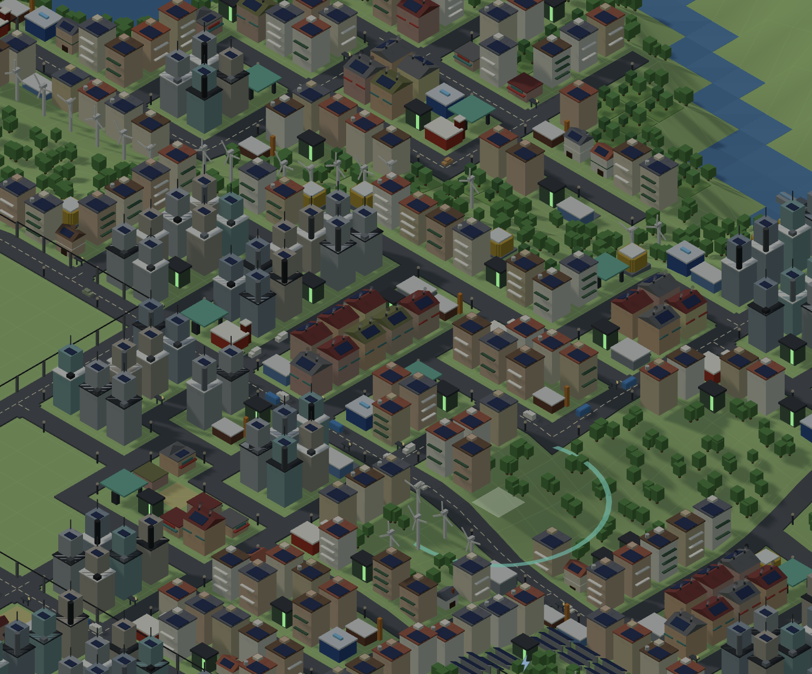

# ⚡ Voltopia

A modern, streamlined city builder for the browser. Your city runs entirely
on renewable energy and every vehicle is electric — balancing fluctuating
generation against consumption is the core of the game.

Built with a low-poly 3D look in the spirit of minimalist city builders:
few key metrics, feedback directly in the world, organic growth, minimal
micromanagement.

## Screenshots

<p align="center">
  
</p>

## Gameplay

- **Build roads** by dragging; intersections, curves and dead ends connect
  automatically. Avenues carry more traffic faster, overpasses cross
  rails and busy roads, bike lanes and pedestrian streets let short
  commutes leave the car at home.
- **Paint zones** — residential, commercial, retail and industrial.
  Buildings appear next to roads when there is demand and densify
  through three levels. Factories run a two-shift load, stock the shops
  and make nearby homes less happy.
- **Power the city** with solar farms, wind turbines (onshore and
  offshore), run-of-river and tidal plants, geothermal wells on seeded
  hotspot fields, batteries, pumped storage, hydrogen electrolysers and
  a dispatchable (but expensive) biogas plant. Plants only supply what
  your **power lines** connect to them; lines and plants partition the
  map into **grid islands** that each balance their own generation and
  storage, and a substation is an island's only link to the outer grid.
- **Water, sea and forest**: every map has a seeded river, a lake, a sea
  edge with a bay at the river mouth, and woodland. Bridge the river,
  plant forest for happiness and shelter, build on the coast for the
  tides and the free wind.
- **Seasons and weather**: a 20-day year with long PV summers, cooling
  load in the afternoon, short dark winters with a heating load on cold
  nights, snowpack that melts into the river in spring, multi-day weather
  fronts and genuine Dunkelflaute spells. A tide clock makes tidal power
  the one predictable source.
- **Watch the balance**: surplus charges batteries, pumped storage and
  the heat store, then runs the electrolysers, then exports, then is
  curtailed. Deficits discharge storage, re-electrify hydrogen, call the
  **demand-response** contract, dispatch biogas, import over the link —
  and beyond that, buildings flicker and go dark, happiness drops,
  growth stops. A **spot market** moves the import and export prices
  with regional weather and time of day; storage can trade on it.
- **Heat**: district-heating plants feed the roads they touch from a
  large heat pump; a heat store banks surplus for cold evenings.
  Insulation halves the heating and cooling load.
- **E-mobility**: the EV fleet grows with your city. Home charging peaks
  in the evening; charging hubs shift the load into the day, the
  **smart-meter rollout** lets charging and household load follow the
  renewable surplus. Electric vans supply the shops from a depot or a
  local factory, buses and trains carry commuters, a rail yard feeds
  passenger and freight trains from its own grid island.
- **Disasters** (intensity chosen when a city is founded): storms that
  feather the wind fleet and strike pylons, fires that spread through
  dense blocks and woods, river floods that climb the banks. Damage puts
  tiles out of service until repaired; fire stations and coverage rings
  matter.
- **Economy and goals**: construction costs, taxes with a slider, upkeep,
  fuel, a budget panel, lifetime statistics and a set of city goals
  (clean day, storm-proof, flexible city, district grid and more) with a
  celebration when all are done.
- **Scenarios**: four hand-made challenges with a stamped starting city,
  a deadline and win/fail conditions — an island without an import link,
  a winter Dunkelflaute, electrifying an old town, a storm season with a
  fragile wind fleet. An objectives panel tracks the run, an end screen
  scores it, and the city stays playable afterwards.
- **Overlays** show supply, demand, services, traffic, deliveries,
  transit, damage, heat and grid islands; the energy panel tracks
  generation per source, consumption, state of charge, curtailment,
  shifted load and every island's own figures.

Also: an **interactive tutorial**, tile inspector, warning icons in the
world, touch gestures, tool hotkeys, synthesized sound effects, a saves
page with named saves plus JSON export/import, a new-game dialog with
map size, difficulty, seed and disaster intensity, and a UI in
**English and German**.

The game saves automatically (IndexedDB) and is playable offline as a PWA.

## Playing with an AI agent

The game exposes its actions as [WebMCP](https://webmachinelearning.github.io/webmcp/)
tools (`document.modelContext`) and, in every browser, on
`window.voltopia` — build, zone, inspect, read the map, fast-forward,
manage saves, start scenarios. See
[docs/agent-tools.md](docs/agent-tools.md).

## Controls

| Input                   | Action                                           |
| ----------------------- | ------------------------------------------------ |
| Left mouse              | Use the selected tool (drag to draw roads/zones) |
| Right/middle mouse drag | Pan the camera                                   |
| Mouse wheel             | Zoom                                             |
| `Q` / `E`               | Rotate the view in 90° steps                     |

## Development

Requirements: Node.js ≥ 22, [pnpm](https://pnpm.io).

```bash
pnpm install
pnpm dev        # start the dev server
pnpm test       # simulation unit tests (Vitest)
pnpm coverage   # tests with coverage (target: >90% for src/sim)
pnpm e2e        # end-to-end tests (Playwright)
pnpm lint       # oxlint
pnpm format     # oxfmt (format:check only verifies)
pnpm audit:prod # fail on high/critical advisories in shipped deps
pnpm build      # production build
```

### Architecture

- `src/sim/` — pure simulation logic, runs in a Web Worker. Deterministic
  (seeded RNG, including weather), fixed tick (4/s), typed-array tile
  layers. No DOM or three.js dependencies.
- `src/render/` — three.js rendering: orthographic isometric camera,
  instanced meshes for roads, buildings, plants and vehicles, day/night
  lighting.
- `src/ui/` — React 19 HUD and tools.
- `src/shared/` — types, the worker message protocol, and the central
  balancing configuration (`constants.ts` — no magic numbers in sim code).
- `src/storage/` — save-game persistence behind a small interface
  (IndexedDB by default).
- `src/agent/` — machine-facing tools (WebMCP + `window.voltopia`) over
  the bridge; DOM-free except for the registration module.

The worker sends only tile diffs and global stats to the main thread,
never the full state. See `docs/idea.md` for the design document and
`docs/plan.md` for the implementation plan.

## Native app (macOS / iPadOS)

The same build runs as a Tauri app. Requirements: Rust (rustup, stable)
and Xcode command line tools; for iPad also Xcode and
`rustup target add aarch64-apple-ios aarch64-apple-ios-sim`.

```bash
pnpm tauri dev                     # macOS window with hot reload
pnpm tauri build                   # .app + .dmg in src-tauri/target/release/bundle/
pnpm tauri ios dev 'iPad Pro 13-inch (M5)'   # iPad simulator
pnpm tauri ios build --export-method debugging  # install on your own iPad
```

Builds are ad-hoc signed, not notarized: on first launch macOS blocks the app; allow it under System Settings → Privacy & Security → Open Anyway, or run `xattr -dr com.apple.quarantine /Applications/Voltopia.app`. Save games live in the app's own storage; use Saves → Export /
Import to move a city between browser and app.

## License

[MIT](LICENSE)
